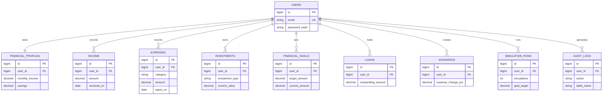

# FutureFinance ER diagram

`users → financial_profiles` is one-to-one. Every other shown user relationship is one-to-many. Lookup values are constrained enums: this avoids duplicate category/type records while retaining 3NF for the data held by this application.
